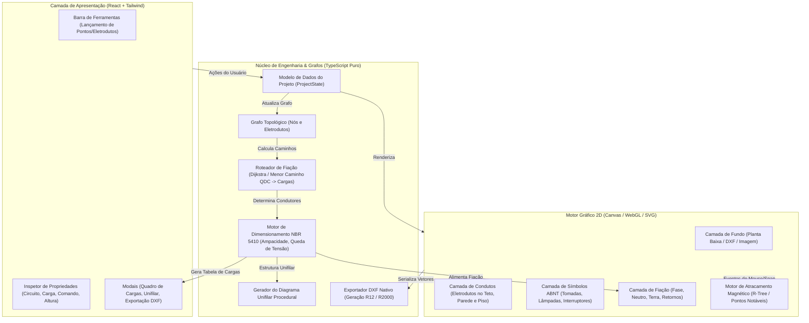

# Arquitetura do Sistema — OpenElétrica

Este documento descreve a arquitetura geral do **OpenElétrica**, os princípios de design, o fluxo de dados unidirecional e o pipeline de renderização gráfica e dimensionamento.

---

## 1. Visão Geral em Alto Nível

O sistema foi concebido como uma aplicação **Offline-First**, executada no navegador sem dependência obrigatória de serviços em nuvem ou processamento remoto. 

---

## 2. Princípios de Separação de Responsabilidades

1. **Desacoplamento do DOM:** A pasta `src/core/` não importa nenhuma biblioteca visual (React, DOM ou Canvas). Toda a lógica matemática, cálculos da norma ABNT e algoritmos em grafos são funções puras e classes TypeScript que podem ser executadas no Node.js ou em Web Workers.
2. **Modelo de Grafo Topológico:** Uma instalação elétrica não é apenas um desenho estático, mas sim uma rede conectada:
   * **Nós ($V$):** Quadros de Distribuição (QDC), Pontos de Iluminação, Tomadas (TUG/TUE), Interruptores, Caixas de Passagem.
   * **Arestas ($E$):** Eletrodutos com propriedades físicas (tipo de instalação, comprimento bidimensional, subida/descida vertical conforme a cota $Z$ dos pontos conectados).
3. **Imutabilidade e Reatividade:** O estado global da aplicação é gerenciado com padrões como Zustand ou Redux Toolkit, disparando recálculos eficientes apenas quando a conectividade do grafo ou as cargas são alteradas.

---

## 3. O Ciclo de Vida de um Projeto

1. **Importação da Arquitetura:**
   * O usuário faz upload de um arquivo `.dxf` ou de uma imagem de planta baixa (`.png`, `.jpg`).
   * Define-se a escala gráfica (ex: medir uma porta padrão de 0,80m para calcular a relação pixels por metro).
2. **Lançamento de Pontos:**
   * Posicionamento do Quadro de Distribuição de Circuitos (QDC).
   * Inserção de pontos de luz no teto, tomadas baixas/médias/altas e interruptores com atracamento magnético às paredes.
3. **Conexão por Eletrodutos:**
   * Desenho de tubulações ligando o QDC aos pontos de consumo. O motor magnético conecta as extremidades às caixas automaticamente.
4. **Atribuição de Circuitos e Comandos:**
   * Associação de cada carga a um circuito elétrico (tensão, potência, disjuntor) e de cada interruptor à sua lâmpada respectiva (letra de comando).
5. **Roteamento Automático de Cabos:**
   * O sistema encontra o menor caminho entre o QDC e cada carga através dos eletrodutos.
   * Determina a quantidade de condutores em cada trecho (Fase, Neutro, Terra e Retornos).
   * O algoritmo anti-colisão posiciona as marcas de fiação sem sobrepor paredes ou cotas.
6. **Dimensionamento e Entregáveis:**
   * O motor da NBR 5410 calcula as correntes corrigidas, quedas de tensão, bitolas de cabos e diâmetros de eletrodutos.
   * Geração imediata do Diagrama Unifilar, Quadro de Cargas e exportação para DXF.
