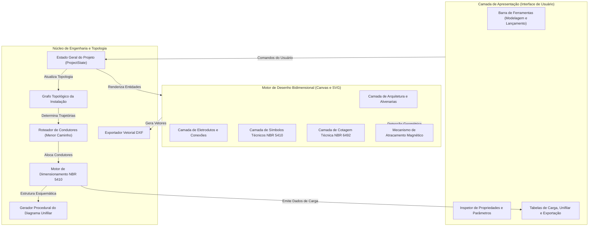

# Arquitetura do Sistema: OpenElétrica

Este documento descreve a organização estrutural do sistema OpenElétrica, seus princípios de projeto, o fluxo de dados e a integração entre o motor gráfico e as rotinas de cálculo normativo.

---

## 1. Visão Geral da Arquitetura

O sistema é construído segundo o paradigma de execução local no cliente (offline-first), executando integralmente no navegador do usuário. A arquitetura divide-se em três camadas principais: Apresentação, Renderização Gráfica e Núcleo de Engenharia.

---

## 2. Princípios de Separação de Responsabilidades

### 2.1 Isolamento do Núcleo de Domínio
O código contido na camada de domínio não possui referências à árvore DOM, contextos gráficos específicos de renderização ou bibliotecas visuais. As regras normativas da ABNT NBR 5410 e os algoritmos espaciais são implementados como módulos puros em TypeScript, viabilizando execução em diferentes ambientes (navegador, Web Workers ou Node.js).

### 2.2 Modelagem em Grafo Topológico
A instalação elétrica é formalizada como uma rede topológica conexa:
* Vértices: Quadros de distribuição, caixas de passagem, pontos de luz, interruptores e tomadas;
* Arestas: Trechos de eletrodutos dotados de propriedades físicas (tipo de instalação, comprimento bidimensional e deslocamentos verticais conforme cotas de altura).

### 2.3 Unidirecionalidade do Fluxo de Informação
As mutações de estado ocorrem de forma determinística por meio de métodos de aplicação. Toda alteração na conectividade física ou na potência das cargas provoca a atualização do grafo, o recálculo dos condutores e a subsequente atualização das representações gráficas.

---

## 3. Fluxo de Trabalho do Projeto

1. Importação da Arquitetura:
   Carregamento de arquivo vetorial DXF ou imagem raster da planta baixa, seguido da definição do fator de escala métrica.
2. Definição Espacial:
   Desenho de alvenarias com espessuras padronizadas, inserção de esquadrias e delimitação de ambientes com determinação automática de área e perímetro.
3. Posicionamento de Componentes:
   Locação do quadro de distribuição, luminárias, pontos de tomada e interruptores com atracamento às alvenarias e caixas.
4. Lançamento da Tubulação:
   Traçado de eletrodutos interligando os pontos da instalação.
5. Associação Elétrica:
   Vinculação dos pontos aos respectivos circuitos e comandos de controle.
6. Roteamento de Fiação:
   Cálculo do caminho ótimo de cabos entre o quadro e os pontos de utilização com posicionamento geométrico dos condutores.
7. Dimensionamento e Saídas Técnicas:
   Avaliação dos critérios de corrente, queda de tensão e taxa de ocupação, permitindo a visualização da prancha em espaço do papel e a exportação em formato DXF.
