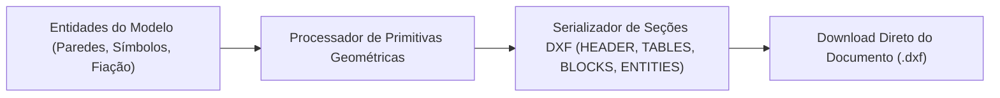

# Motor Gráfico CAD e Conversão DXF: OpenElétrica

Este documento descreve as especificações técnicas do motor de renderização bidimensional, os sistemas de coordenadas, as rotinas de atracamento magnético e o processo de exportação vetorial em formato DXF.

---

## 1. Espaços de Coordenadas e Transformações Geométricas

O sistema trabalha com dois espaços de referência coordenados:

### 1.1 Espaço do Modelo (Coordenadas Reais do Mundo em Metros)
* Todas as entidades geométricas (alvenarias, caixas, tubulações e cotas) possuem coordenadas expressas em metros na escala real da edificação (1 unidade gráfica equivale a 1 metro).
* Componentes possuem coordenadas tridimensionais (X, Y, Z), onde a coordenada Z define a cota de instalação (exemplo: tomada baixa em Z = 0,30 m; interruptores em Z = 1,20 m; pontos de teto em Z = 2,80 m).

### 1.2 Espaço da Tela (Coordenadas de Exibição em Pixels)
A projeção das entidades no elemento Canvas é governada por uma matriz afim de transformação de visualização:

$$\begin{pmatrix} X_{\text{tela}} \\ Y_{\text{tela}} \end{pmatrix} = \begin{pmatrix} \text{escala} \cdot \cos\theta & -\text{escala} \cdot \sin\theta \\ \text{escala} \cdot \sin\theta & \text{escala} \cdot \cos\theta \end{pmatrix} \begin{pmatrix} X_{\text{mundo}} \\ Y_{\text{mundo}} \end{pmatrix} + \begin{pmatrix} \text{transl}_X \\ \text{transl}_Y \end{pmatrix}$$

O mecanismo suporta translação livre e ampliação de visualização na faixa contínua de 10% a 1000%, preservando a estabilidade da taxa de quadros.

---

## 2. Mecanismo de Atracamento Magnético (Snapping)

Para assegurar a precisão no desenho e a conectividade entre elementos, o sistema emprega uma árvore de índices espaciais em memória (R-Tree):

* Modos de Atracamento:
  * Vértice de Parede (Endpoint): Conexão direta às quinas e terminais de alvenaria;
  * Ponto Médio (Midpoint): Detecção do centro geométrico de segmentos lineares;
  * Centro de Caixa: Ponto focal de caixas embutidas ou luminárias;
  * Projeção Perpendicular: Atracamento em ângulo reto sobre faces de parede;
  * Alinhamento Polar e Ortogonal: Travamento angular nas direções de 0, 45, 90, 135, 180, 225, 270 e 315 graus;
  * Boneca Arquitetônica: Ponto de afastamento padronizado de 10 cm em relação às quinas internas para inserção de portas.
* Tolerância de Detecção: Raio padrão de 15 a 25 pixels na tela, recalculado proporcionalmente ao fator de zoom da visualização.

---

## 3. Conversão e Exportação para Formato DXF

A exportação de desenhos vetoriais ocorre inteiramente no navegador, gerando documentos DXF no padrão aberto R12 ASCII:

### 3.1 Camadas de Desenho Padronizadas
As entidades exportadas são distribuídas nas seguintes camadas (layers):
* ARQUITETURA_PAREDES: Linhas de alvenaria e divisórias;
* ARQUITETURA_ESQUADRIAS: Folhas, batentes e arcos de abertura de portas e janelas;
* ARQUITETURA_COTAS: Linhas de chamada, linhas de cota e valores métricos (NBR 6492);
* ELETRICA_ELETRODUTOS_TETO: Tubulações embutidas em laje ou instaladas em entreforro;
* ELETRICA_ELETRODUTOS_PISO: Tubulações embutidas em piso ou envelopadas;
* ELETRICA_PONTOS: Blocos e simbologias de caixas, tomadas e luminárias;
* ELETRICA_CONDUTORES: Representação gráfica dos condutores de circuito;
* ELETRICA_TEXTOS: Identificadores de circuitos, comandos, potências e bitolas.
