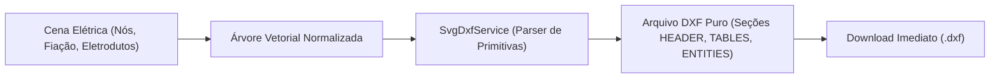

# Motor de CAD & Conversão DXF — OpenElétrica

Este documento descreve o funcionamento do motor de desenho 2D no navegador, o sistema de coordenadas e escalas, a mecânica de atracamento magnético (*snapping*) e a conversão vetorial direta para arquivos DXF (AutoCAD).

---

## 1. Espaços de Coordenadas e Escalas

O sistema opera com dois sistemas de coordenadas fundamentais:

1. **Coordenadas do Mundo (*World Space* - Metros):**
   * Posições reais físicas na planta baixa.
   * Tomadas e caixas têm coordenadas $(X, Y, Z)$ em metros (ex: tomada baixa em $Z = 0,30\,\text{m}$, arandela em $Z = 1,20\,\text{m}$, teto em $Z = 2,80\,\text{m}$).
   * Eletrodutos calculam seu comprimento tridimensional real a partir do espaço do mundo.
2. **Coordenadas da Tela (*Screen/Canvas Space* - Pixels):**
   * Transformação afim com matriz de visualização:
     $$\begin{pmatrix} X_{\text{tela}} \\ Y_{\text{tela}} \end{pmatrix} = \begin{pmatrix} \text{scale} \cdot \cos\theta & -\text{scale} \cdot \operatorname{sen}\theta \\ \text{scale} \cdot \operatorname{sen}\theta & \text{scale} \cdot \cos\theta \end{pmatrix} \begin{pmatrix} X_{\text{mundo}} \\ Y_{\text{mundo}} \end{pmatrix} + \begin{pmatrix} \text{pan}_X \\ \text{pan}_Y \end{pmatrix}$$
   * Permite *Pan* infinito e *Zoom* contínuo de 10% a 1000% mantendo 60 quadros por segundo.

---

## 2. Sistema de Snapping Magnético (Atracamento)

Para que o lançamento de pontos seja rápido e não deixe tubulações desconectadas, o sistema mantém um **Índice Espacial R-Tree** em memória (`rbush`):

* **Tipos de Atracamento:**
  * **Center Snap:** Centro geométrico de caixas octogonais de teto e caixas de embutir 4x2/4x4.
  * **Wall Snap:** Projeção perpendicular mais próxima na face de uma parede de alvenaria.
  * **Endpoint Snap:** Extremidades livres de eletrodutos já lançados.
  * **Midpoint Snap:** Ponto médio de segmentos de parede.
* **Raio de Atracamento (*Snap Tolerance*):** 12 pixels na tela, recalculados inversamente pelo fator de zoom para que a sensibilidade tátil do cursor seja constante em qualquer escala de visualização.

---

## 3. Pipeline de Exportação DXF Direta no Cliente

Ao contrário dos softwares tradicionais que dependem de bibliotecas C++ pesadas no servidor, o exportador serializa a cena vetorial diretamente no navegador em formato **AutoCAD DXF R12 / ASCII**:

### 3.1 Mapeamento de Camadas (Layers DXF)
Os elementos exportados são organizados em camadas padrão com cores e espessuras convencionadas:
* `ELETRICA_ELETRODUTO_TETO`: Tubulação de laje/teto (Linha contínua, cor ciano);
* `ELETRICA_ELETRODUTO_PISO`: Tubulação enterrada/embutida em piso (Linha tracejada, cor amarela);
* `ELETRICA_SIMBOLOS`: Blocos de tomadas, interruptores e luminárias;
* `ELETRICA_FIACAO`: Riscos normatizados de condutores e letras de comando;
* `ELETRICA_TEXTOS`: Identificadores de circuitos, potências e bitolas;
* `ELETRICA_QUADRO_CARGAS`: Tabela de dimensionamento e diagramas unifilares.
