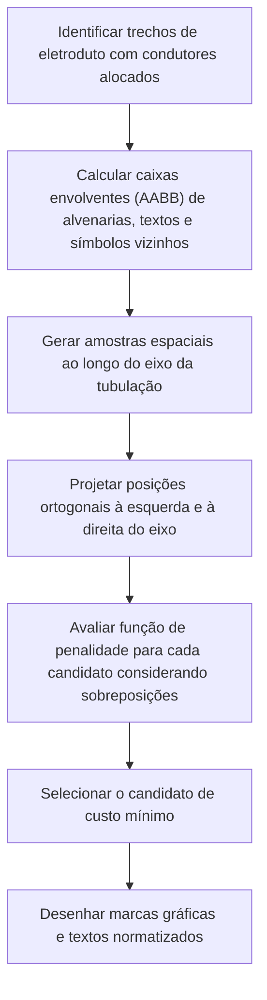

# Roteamento de Fiação e Otimização Espacial: Algoritmos e Topologia

Este documento descreve a formalização do grafo da rede elétrica, as rotinas de roteamento de condutores e o algoritmo geométrico empregado na resolução de posições de fiação sem sobreposição visual.

---

## 1. Topologia da Rede em Grafo Ponderado

A malha de tubulações e caixas é representada formalmente como um grafo conexo não-direcionado $G = (V, E)$:

### 1.1 Conjunto de Vértices ($V$)
* Vértices de Distribuição: Quadro Geral de Baixa Tensão (QGBT) e Quadros de Distribuição (QD);
* Vértices de Consumo: Luminárias de teto, arandelas de parede e tomadas (TUG e TUE);
* Vértices de Manobra: Interruptores simples, paralelos (three-way) e intermediários (four-way);
* Vértices de Passagem: Caixas octogonais de laje ou caixas de derivação em alvenaria.

### 1.2 Conjunto de Arestas ($E$)
Cada trecho físico de eletroduto conectando dois vértices constitui uma aresta ponderada. O peso $w(e)$ corresponde à distância euclidiana tridimensional real entre os nós:

$$w(e) = \sqrt{(x_B - x_A)^2 + (y_B - y_A)^2 + (z_B - z_A)^2}$$

Essa formulação assegura a contabilização correta das subidas e descidas de tubulação em paredes para a determinação quantitativa de condutores e avaliação de queda de tensão.

---

## 2. Determinação e Alocação de Condutores

### 2.1 Trajeto do Quadro de Distribuição às Cargas
Para cada circuito cadastrado:
1. Aplica-se o algoritmo de caminhos mínimos de Dijkstra entre o vértice do quadro de distribuição e cada carga associada ao circuito.
2. Em cada aresta pertencente à rota calculada:
   * Aloca-se condutor de fase e condutor neutro do circuito em questão;
   * Aloca-se condutor de proteção (terra), exigido em todas as ramificações de circuitos terminais.

### 2.2 Condutores de Comando
Para pontos de iluminação controlados por interruptores:
* Comando Simples:
  O eletroduto interligando a caixa de teto à caixa de parede recebe um condutor de fase e um condutor de retorno com a identificação alfabética do comando.
* Comando Paralelo (Three-Way):
  Entre os dois interruptores paralelos são alocados dois condutores de retorno em paralelo. A fase alimenta o primeiro dispositivo e o retorno da lâmpada parte do segundo.
* Comando Intermediário (Four-Way):
  O trecho intermediário entre dois paralelos conduz quatro condutores de retorno (dois condutores de entrada e dois condutores de saída).

---

## 3. Algoritmo de Otimização e Anti-Colisão de Rótulos

A rotina de posicionamento das marcas gráficas de condutores nos eletrodutos opera conforme o seguinte fluxo determinístico:

### 3.1 Proporções Gráficas da Simbologia de Fiação
O traçado dos condutores é executado ortogonalmente ao eixo da tubulação:
* Fase: Segmento contínuo centrado cortando o eixo da tubulação;
* Neutro: Segmento vertical com terminação em ângulo reto apontando à direita;
* Retorno: Segmento superior perpendicular ao eixo da tubulação com indicação da letra de comando;
* Terra: Segmento vertical com terminação em barra horizontal formando um T simétrico;
* Identificadores: O número do circuito é posicionado no campo superior dos condutores e a seção nominal é indicada no campo inferior caso divirja do padrão geral da instalação.
