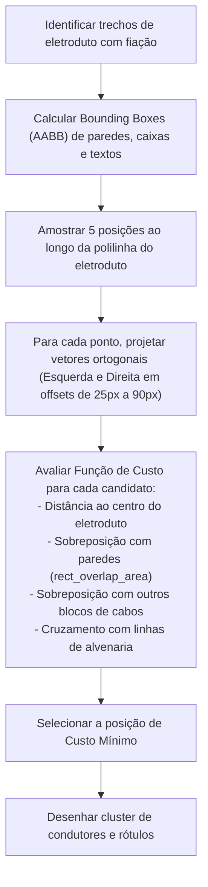

# Algoritmo de Roteamento de Fiação & Anti-Colisão

Este documento detalha o funcionamento do **grafo elétrico**, a determinação dos caminhos de condutores e o algoritmo geométrico anti-colisão utilizado para posicionar as marcações de condutores na prancha.

---

## 1. O Grafo Topológico da Instalação

A rede de distribuição é modelada como um **Grafo Conexo Ponderado Não-Direcionado** $G = (V, E)$:

* **Vértices ($V$):**
  * `PanelNode`: Quadro Geral (QGBT) ou Quadro de Distribuição (QD);
  * `LoadNode`: Pontos de Luz no Teto, Arandelas, Tomadas (TUG/TUE);
  * `SwitchNode`: Interruptores simples, paralelos (*Three-Way*), intermediários (*Four-Way*);
  * `JunctionNode`: Caixas de passagem octogonais ou 4x4.
* **Arestas ($E$):**
  * Trechos de eletrodutos entre dois nós.
  * O peso da aresta $w(e)$ é a distância euclidiana tridimensional real:
    $$w(e) = \sqrt{(x_B - x_A)^2 + (y_B - y_A)^2 + (z_B - z_A)^2}$$
    Isso garante que a subida/descida vertical da tubulação seja contabilizada na metragem física de cabos e no cálculo de queda de tensão.

---

## 2. Determinação de Condutores em Cada Eletroduto

### 2.1 Roteamento do QDC até as Cargas
Para cada circuito $C$:
1. Executa-se o algoritmo de menor caminho (**Dijkstra**) partindo do nó do Quadro ($Q$) até cada ponto de carga $L \in C$.
2. Para cada aresta $e$ percorrida pelo caminho:
   * Aloca-se condutor de **Fase** e **Neutro** correspondentes ao circuito $C$.
   * Aloca-se condutor de **Proteção (Terra)** (obrigatório em todos os trechos de circuito terminal).

### 2.2 Roteamento de Comandos e Interruptores
Para lâmpadas acionadas por interruptor:
* **Interruptor Simples:**
  * O eletroduto entre a caixa de teto e o interruptor recebe a **Fase** do circuito até o interruptor, e o condutor de **Retorno** volta do interruptor até a lâmpada.
* **Interruptor Paralelo (Three-Way):**
  * Entre os dois interruptores paralelos trafegam **dois condutores de retorno** em paralelo. A fase entra no primeiro interruptor e o retorno da lâmpada sai do segundo.
* **Interruptor Intermediário (Four-Way):**
  * Inserido no trajeto intermediário entre dois paralelos, conduzindo quatro retornos (dois de entrada e dois de saída).

---

## 3. Algoritmo Geométrico Anti-Colisão (`organize_wires_layout`)

Especificação da lógica de otimização espacial:

### 3.1 Desenho Gráfico dos Condutores (Proporções ABNT)
O desenho de cada condutor é perpendicular ao eixo da tubulação:
* **Fase:** Segmento vertical total de $20\,\text{px} \times \text{scale}$ cortando a tubulação centralmente.
* **Neutro:** Segmento vertical com bandeira horizontal de $4\,\text{px}$ à direita no topo superior.
* **Retorno:** Meio segmento de $10\,\text{px}$ projetado para cima a partir da tubulação. Letra do comando impressa acima dele.
* **Terra:** Segmento vertical com travessão em "T" simétrico no topo (de $-4\,\text{px}$ a $+4\,\text{px}$).
* **Rótulos Numéricos:**
  * Número do circuito centralizado acima dos condutores de fase/neutro.
  * Bitola do cabo indicada abaixo do condutor apenas quando diferir da bitola padrão residencial ($2,5\,\text{mm}^2$).
